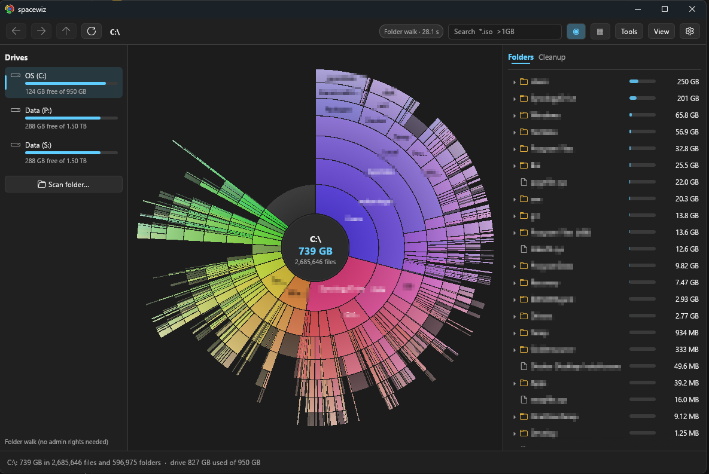
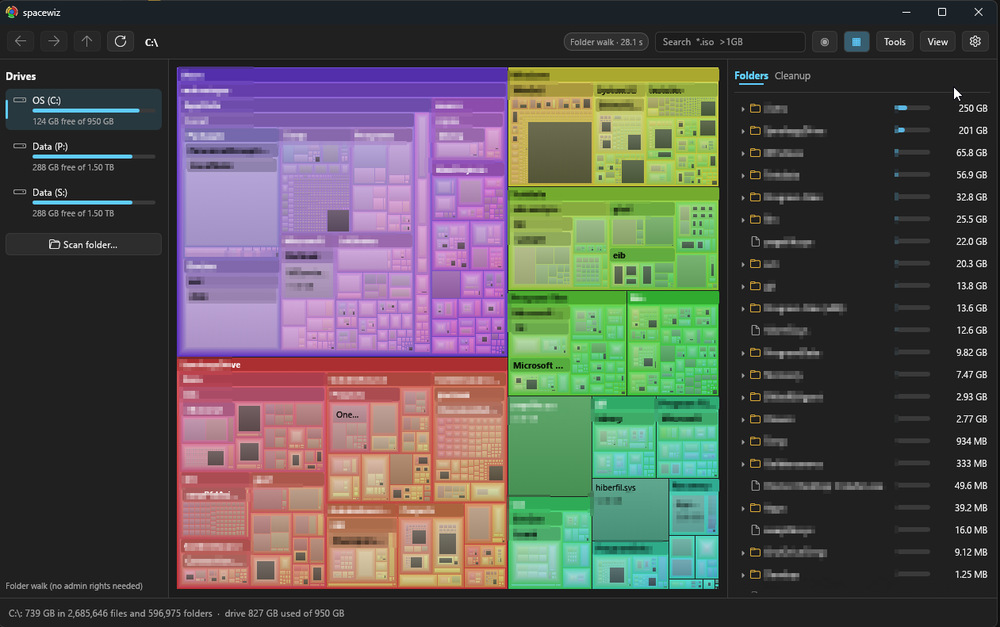

<div align="center">


# spacewiz

**See where your disk space went — in one glance.**

A fast, modern disk space analyzer for Windows with an interactive sunburst chart and treemap.
Written in Rust. A single `.exe`, no installer, no admin rights needed.


<br>



</div>

---

## ✨ Highlights

<table>
<tr>
<td width="50%" valign="top">

### 🌀 Explosion chart
Your folders as concentric rings: the folder in focus sits in the centre, deeper levels radiate outward,
every slice sized by the space it takes. **Hover** a slice and it lifts out of the chart together with
everything inside it, while a card shows its size, share, file count, newest file and path.

</td>
<td width="50%" valign="top">

### ⚡ Fast — with or without admin
As administrator, NTFS drives are read straight from the **Master File Table**, like WizTree: a whole drive
in seconds. As a normal user, folders are walked in parallel on all cores — a full system drive with over
3 million items in about 20 seconds.

</td>
</tr>
<tr>
<td valign="top">

### 👀 Live while scanning
No waiting for a progress bar: the chart fills in as folders are read. Hover, zoom and explore while the
scan runs — you stay where you are when it finishes.

</td>
<td valign="top">

### 🧭 Effortless navigation
Click a folder to zoom in (smoothly animated), click the centre to go up. Mouse wheel in and out,
breadcrumbs, back/forward (also with the mouse side buttons), `Backspace`, `Alt+←/→/↑`.

</td>
</tr>
<tr>
<td valign="top">

### 🔎 Search & highlight
`Ctrl+F`, type `*.iso >1GB` — matches light up in the chart, everything else fades. Wildcards, several
terms at once, size filters, `file:` / `folder:`.

</td>
<td valign="top">

### 🧹 Cleanup hints
Finds the usual space hogs — temp folders, browser and package caches (npm, cargo, pip, Maven, Gradle,
NuGet), build output (`node_modules`, `target`, `bin`/`obj`), crash dumps, the Recycle Bin — and explains
what each one is. Suggestions only; nothing is deleted behind your back.

</td>
</tr>
<tr>
<td valign="top">

### 👯 Duplicate finder
Same size → same first 64 KB → same full-content hash (xxh3), in parallel. Shows the space wasted per group.
Online-only cloud files (OneDrive, Synology Drive…) are **never** read, so nothing gets downloaded, and hard
links don't count as copies.

</td>
<td valign="top">

### 🎨 Colour by folder, type or age
Each top-level branch its own hue — or colour files by type, or by **age** (from "this week" to "untouched
for years") to spot stale data at a glance.

</td>
</tr>
</table>

---

## 🗺️ Treemap view

One click in the toolbar switches to a squarified treemap — same colours, same hover card, same search
highlighting and right-click menu. Great for spotting the single huge file hiding in a sea of small ones.

<div align="center">

</div>

---

## 🧰 Everything else

| | |
|---|---|
| **Right-click menu** | Open · Show in Explorer · Copy path · Rescan folder · Find duplicates here · Skip in future scans · Move to Recycle Bin (asks first, chart updates in place) |
| **Side tabs** | Folder tree with size bars · File types (click to highlight) · Largest files · Cleanup · Search results · Duplicates — pick the ones you want in the View menu |
| **Skip folders** | Exclude slow or uninteresting folders by path (`C:\Windows\WinSxS`) or by name (`node_modules`) — halves the time of a full system-drive scan |
| **Drag & drop** | Drop a folder or drive on the window to scan it; drag a slice or list row out to Explorer to copy the file |
| **Drives panel** | All drives with label, usage bar and free space; free space also appears as a grey slice in the chart |
| **Size modes** | File length or actual space on disk (compressed, sparse and cloud files counted correctly) |
| **Look & feel** | Windows 11 style, Segoe UI, light and dark theme (follows Windows) |

---

## 🚀 Getting started

Download or build `spacewiz.exe` and run it — that's it. Pick a drive on the left, or drop a folder on the
window.

```text
spacewiz.exe                          open the window
spacewiz.exe D:\Data                  open and scan a folder
spacewiz.exe D:\Data --search "*.iso" scan, then search
spacewiz.exe D:\Data --find-dupes     scan, then look for duplicate files
spacewiz.exe --scan C:\ [--walk]      scan without a window: totals, time, largest items
spacewiz.exe --dupes D:\Data          list duplicate files without a window
spacewiz.exe --console                show the log in a console
```

> 💡 **Want the MFT speed?** On an administrator account a **Fast scan** button appears in the toolbar — it
> restarts spacewiz elevated. Standard users don't see it and always get the parallel walk.

### Keyboard & mouse

| Action | Keys / mouse |
|---|---|
| Zoom into a folder | Click · mouse wheel up · double-click in a list |
| Up one level | Click the centre · mouse wheel down · `Backspace` · `Alt+↑` |
| Back / forward | `Alt+←` / `Alt+→` · mouse side buttons |
| Search | `Ctrl+F` · `Esc` clears search and highlight |
| Rescan the folder in view | `F5` |
| Open a file | Double-click |

### Settings

Everything is adjustable in the app (⚙) and saved to `config.toml` next to the exe — theme, side tabs,
number of rings, size mode, colours, free space, skip list, minimum duplicate size. Comments in the file are
kept when the app saves. The log is in `logs\spacewiz.log`. Set `SPACEWIZ_HOME` to keep both somewhere else.

---

## ⚙️ How it works

- **MFT reader** (administrator, NTFS): opens the volume, reads the `$MFT` data runs, then the whole table in
  large sequential chunks; records are parsed in parallel (fixups, `$FILE_NAME`, `$DATA`,
  `$STANDARD_INFORMATION`) and linked into a tree by parent record number.
- **Parallel walk** (everyone): `FindFirstFileExW` with large fetch on a work-stealing thread pool, straight
  into a shared tree with running totals — which is what lets the chart draw while scanning. Junctions and
  symbolic links are not followed, so nothing is counted twice.
- **Rendering**: [egui](https://github.com/emilk/egui) — every slice is a tessellated mesh with hairline gaps
  and a soft gradient; zooming interpolates each slice from its old place to its new one.

<details>
<summary><b>Code map</b></summary>

| File | What it does |
|---|---|
| `src/main.rs` | Arguments, `--scan`, `--dupes`, window setup |
| `src/scan/mod.rs` | Picks MFT or walk, background scan thread, progress counters, live tree, skip list |
| `src/scan/mft.rs` | Raw MFT reader |
| `src/scan/walk.rs` | Parallel folder walk into a shared tree; flags cloud placeholders |
| `src/tree.rs` | Arena tree: totals, newest file per folder, sorting, remove, replace subtree, type totals, largest files |
| `src/chart.rs` | Shared by both views: colours (folder/type/age), highlighting, hover card, age legend |
| `src/sunburst.rs` | Sunburst layout, painting, hit testing, hover lift, zoom animation |
| `src/treemap.rs` | Squarified treemap layout, painting, hit testing, zoom animation |
| `src/search.rs` | Query parsing (wildcards, size filters) and search |
| `src/cleanup.rs` | Rules for caches, temp and build folders |
| `src/dupes.rs` | Duplicate finder (size → partial hash → full hash) |
| `src/ui.rs` | The window: drives, toolbar, search, live view, side tabs, menus, drag & drop, settings |
| `src/theme.rs` | Windows 11 style, fonts, palettes, app icon |
| `src/drives.rs` · `src/actions.rs` | Drives and free space · elevation, open, Explorer, Recycle Bin |
| `src/config.rs` · `src/default_config.toml` | Settings |

</details>

---

## 🔨 Building

Rust 1.85+ (edition 2024) with the MSVC toolchain. Build from PowerShell (Git Bash can put GNU `link` ahead of
MSVC's).

```powershell
cargo build --release   # target\release\spacewiz.exe — one exe, C runtime linked statically
cargo test
```

## 📝 Notes

- MFT mode needs NTFS and administrator rights; FAT32, exFAT, ReFS and network drives are always walked.
- Hard-linked files are counted once; alternate data streams are not counted.
- In walk mode, folders Windows refuses to list (other users' profiles, `System Volume Information`) are left
  out — the scan badge in the toolbar tells you how many.
- The very first scan after a reboot is slower: Windows has to read the folder structure from disk instead of
  from its cache.
